# Stretcher — daily stretching in Telegram

A daily stretching service that runs as a **Telegram Mini App** — no install needed: open the bot and start a session. It ships with **61 programs** and **140 exercises**, each with an illustration and a technique description, a body-map picker, a routine builder, progress stats and subscriptions paid with Telegram Stars or YooKassa.

**Live:** [@stretcher_robot](https://t.me/stretcher_robot)

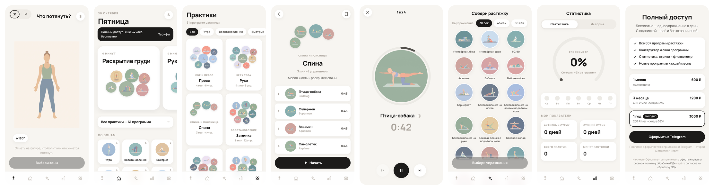

## Contents

- [Screens](#screens)
- [Features](#features)
- [Architecture](#architecture)
- [Payments and access](#payments-and-access)
- [API](#api)
- [Content pipeline](#content-pipeline)
- [Getting started](#getting-started)
- [Deployment](#deployment)

## Screens

| Body map | Today | Programs | Program |
|:---:|:---:|:---:|:---:|
| 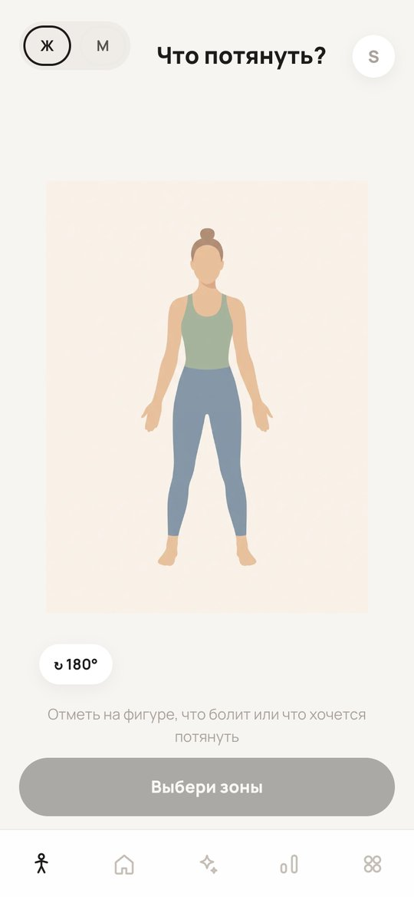 | 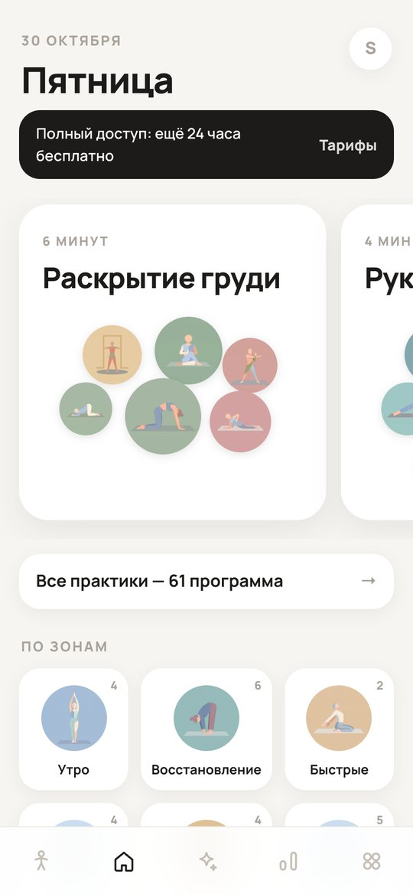 | 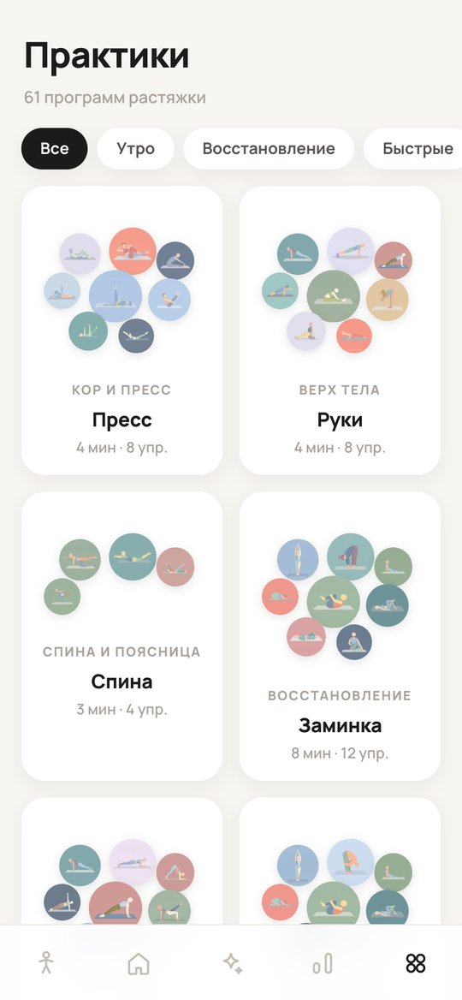 | 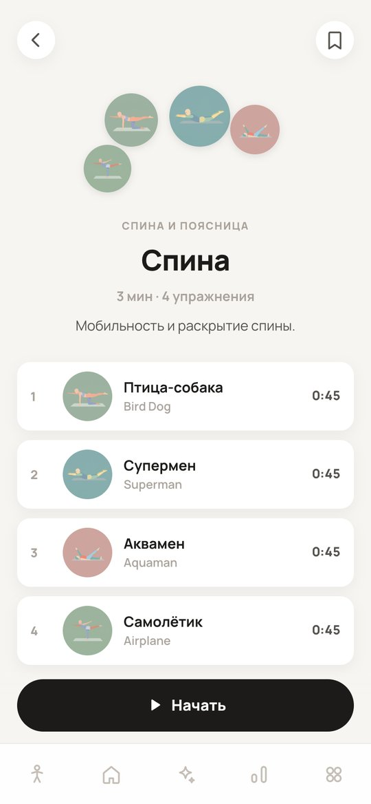 |
| **Player** | **Builder** | **Stats** | **Paywall** |
| 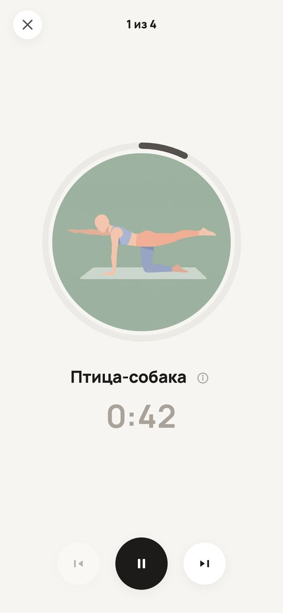 | 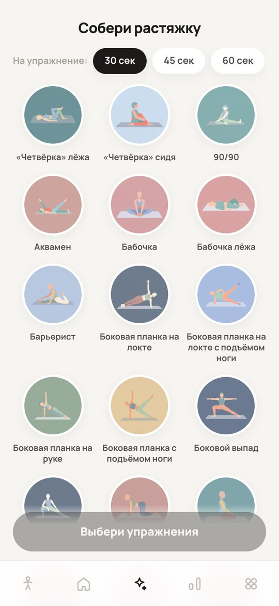 | 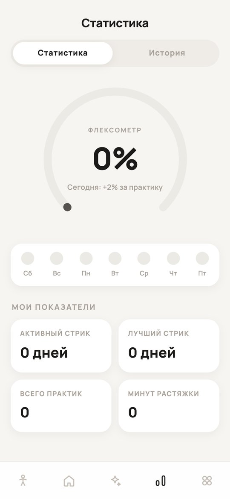 | 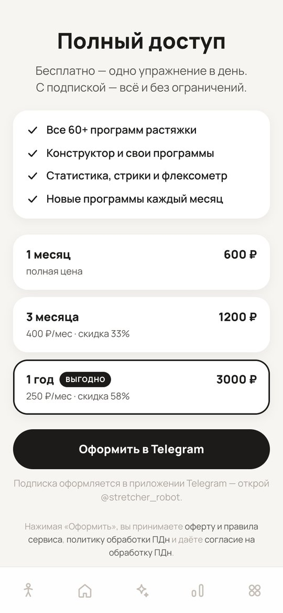 |

## Features

| Feature | Description |
|---|---|
| **"What to stretch?"** | Interactive body map — female / male figure, front and back. Tap the areas that hurt or feel tight and get matching programs. |
| **Programs** | 61 routines across 11 categories (morning, office, lower back, recovery, quick…), 3 to 30 minutes each. |
| **Player** | Progress-ring timer, auto-advance between exercises, pause / skip, and a "how to do it" sheet for every exercise. |
| **Builder** | Compose your own routine from 140 exercises with 30 / 45 / 60 s per exercise and save it to "My programs" (synced to the backend). |
| **Stats** | "Flexometer" (cumulative regularity score), streaks, weekly activity, history and total minutes. |
| **Pick of the day** | Three programs rotated daily on the Today screen. |
| **Profile** | Subscription status, custom programs, legal documents and personal-data consent revocation. |

Outside Telegram the app still works as a regular mobile web app / PWA — Telegram integrations (haptics, CloudStorage, BackButton) simply turn into no-ops.

## Architecture

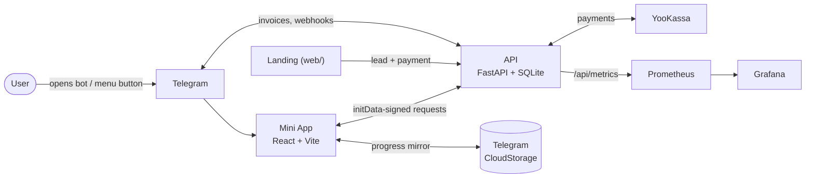

| Part | Technology |
|---|---|
| Mini App (`miniapp/`) | React, Vite, React Router (hash), Telegram WebApp SDK, PWA; Capacitor config for native builds |
| API (`api/`) | FastAPI, SQLite, httpx, prometheus-client |
| Landing (`web/`) | React, Vite |
| Infra | Docker, Caddy, Prometheus, Grafana |

Progress is stored locally first and mirrored to Telegram CloudStorage and the backend, so it survives device changes.

## Payments and access

| Mode | What is available |
|---|---|
| Trial (first 24 hours) | Everything |
| Free | One "exercise of the day" per day, the rest is locked |
| Subscription | Everything, no limits |

| Plan | Price | Telegram Stars |
|---|---|---|
| 1 month | 600 ₽ | 375 ⭐ |
| 3 months | 1 200 ₽ | 750 ⭐ |
| 1 year | 3 000 ₽ | 1 875 ⭐ |

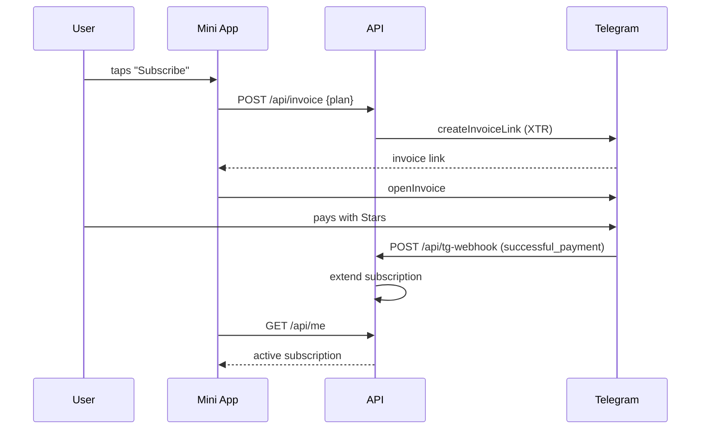

YooKassa works the same way through `/api/pay/yookassa`, a status check and the `/api/yk-webhook` callback.

## API

| Method | Path | Purpose |
|---|---|---|
| `GET` | `/api/me` | current user, trial and subscription state |
| `POST` | `/api/invoice` | create a Telegram Stars invoice |
| `GET` | `/api/pay/methods` | available payment methods |
| `POST` | `/api/pay/yookassa` | create a YooKassa payment |
| `POST` | `/api/pay/yookassa/check` | check payment status |
| `POST` | `/api/yk-webhook` | YooKassa callback |
| `POST` | `/api/tg-webhook` | Telegram bot webhook (payments, commands) |
| `GET` / `PUT` | `/api/custom-routines` | user-built programs |
| `POST` | `/api/consent/revoke` | revoke personal-data consent |
| `POST` | `/api/lead`, `GET /api/lead/status` | leads and payments from the landing |
| `GET` | `/api/metrics` | Prometheus metrics |
| `GET` | `/api/health` | health check |

All Mini App requests are authenticated with Telegram `initData`.

## Content pipeline

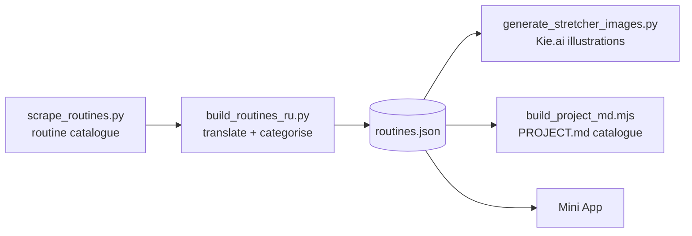

- `build_routines_ru.py` translates program and exercise names into Russian and assigns categories
- `generate_stretcher_images.py` generates flat-style square illustrations for every exercise through the Kie.ai API (`KIE_API_KEY`)
- [`PROJECT.md`](PROJECT.md) is generated from the app data and contains the full program and exercise catalogue

## Getting started

```bash
cd miniapp
npm install
npm run dev        # http://localhost:5173 — use a mobile viewport in DevTools
```

API:

```bash
cd api
pip install -r requirements.txt
BOT_TOKEN=... uvicorn app:app --reload --port 8080
```

## Deployment

`scripts/deploy.sh` deploys strictly through git: it refuses to run with a dirty tree, pushes to GitHub, pulls on the server, rebuilds the containers and swaps them. `deploy/` contains the Caddy block and the Grafana dashboards.
